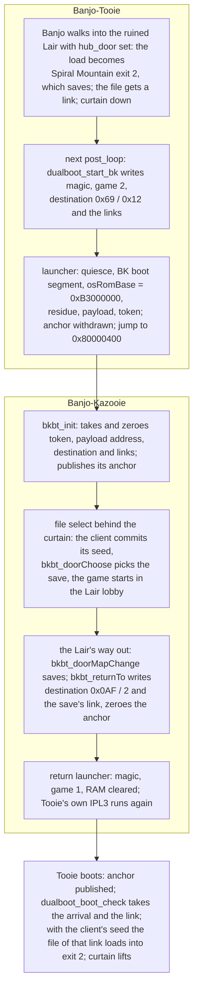

# Dual-boot contract 5

The contract between the two ROM hacks of this repository when they share one cartridge image: the Banjo-Tooie
Archipelago hack (`hack/bt`, a fork of the Tooie AP ROM hack) and the Banjo-Kazooie Archipelago hack (the fork of the
Banjo-Kazooie decomp in `hack/bk/decomp`, with the small payload in `hack/bk/asm`). It says where everything lies in
the image and in RAM, which words the two games pass each other, who may write each word and how, and how the two
games share one save device.

The code is the authority. Where this page and the code disagree, the code is right:

| What | Defined in |
|---|---|
| The handoff block (Tooie owns the layout), the hub door's constants, the SRAM border | [`hack/bt/n64/src/dualboot.h`](../hack/bt/n64/src/dualboot.h), [`dualboot.c`](../hack/bt/n64/src/dualboot.c) |
| The launcher Tooie -> Banjo-Kazooie, its tags | [`hack/bt/n64/asm/dualboot.asm`](../hack/bt/n64/asm/dualboot.asm), [`dualboot_quiesce.asm`](../hack/bt/n64/asm/dualboot_quiesce.asm) |
| Tooie's doors, arrivals and curtain; its exit tables | [`hack/bt/n64/src/door.c`](../hack/bt/n64/src/door.c), [`exits.c`](../hack/bt/n64/src/exits.c), [`hack/bt/shared/include/ap_memory/pc.h`](../hack/bt/shared/include/ap_memory/pc.h) |
| Banjo-Kazooie's mirror of the block, its anchor and exit map | [`hack/bk/decomp/include/bkbt.h`](../hack/bk/decomp/include/bkbt.h), [`src/core1/code_0.c`](../hack/bk/decomp/src/core1/code_0.c) |
| The payload and the return launcher Banjo-Kazooie -> Tooie | [`hack/bk/asm/payload.asm`](../hack/bk/asm/payload.asm), [`return.asm`](../hack/bk/asm/return.asm) |
| Banjo-Kazooie's save | [`src/core1/eeprom.c`](../hack/bk/decomp/src/core1/eeprom.c), [`include/save.h`](../hack/bk/decomp/include/save.h), [`manual_syms.us.v10.txt`](../hack/bk/decomp/manual_syms.us.v10.txt) |
| The image and what it refuses | [`tools/make_dualboot_image.py`](../tools/make_dualboot_image.py), [`tools/bk_fork_info.py`](../tools/bk_fork_info.py) |

The fork's notes on its side are in [`hack/bk/decomp/BKBT.md`](../hack/bk/decomp/BKBT.md). Terms used below: a
**cart offset** is a position in the image file, which the PI (the cartridge bus's DMA engine) addresses as
`0x10000000 + offset` and the CPU reads at `0xB0000000 + offset`. **KSEG0** (`0x80xxxxxx`) and **KSEG1** (`0xA0xxxxxx`) are two CPU
addresses for the same RAM, through the data cache and around it; a cached store reaches RAM later, as a whole
16-byte line. The **IPL3** is the boot code at ROM `0x40..0x1000`, tied to the lockout chip (Banjo-Kazooie CIC-6103,
Tooie CIC-6105): it loads the game's first megabyte (the "boot segment", cart `0x1000`) to `0x80000400` and jumps
there. **Expansion Pak RAM** is `0x80400000..0x80800000`; Banjo-Kazooie uses only the lower 4 MiB.

## 1. Overview

The image is one 64 MiB ROM. Whatever loads it reads the Tooie hack's header at offset 0 and boots it as the Tooie
hack: CIC-6105, SRAM 256k, Expansion Pak. Banjo-Kazooie sits higher up, not relocated. Either game can start the
other without a reset: a **launcher** stops the running game, puts the console into the state the other game expects
at power-on and jumps into it. The games tell each other why they were started through the **handoff block**, 64 bytes of Expansion
Pak RAM at `0x805FFF00`, which survives the switch. Three things switch games:

- **The chord**, L + R + Start, on Tooie's title screen and in Banjo-Kazooie's front end. It arrives at the other
  game's front end.
- **A door**: the hub door (Tooie's Spiral Mountain entrance to its ruined Lair leads into Banjo-Kazooie's Lair, and
  the Lair's way out leads back) and, since contract 5, the doors between the games (a world entrance of either game
  may lead into a world of the other). A door arrives at a destination, in the save tied to the file that went
  through it.
- **The end of a played Banjo-Kazooie game** (Save and Quit, the ending): back to Tooie's title.

A trip through the hub door and back:

## 2. The image

Exactly `0x4000000` bytes (64 MiB, the most emulators and flashcarts take), assembled by
[`tools/make_dualboot_image.py`](../tools/make_dualboot_image.py); everything not listed is zero:

| Cart offset | Content |
|---|---|
| `0x0000000` | The Tooie hack's ROM: Tooie's header, its CIC-6105 IPL3, the game, the hack's own payload from `0x2000000`. The file must end by `0x2100000` (the hack's boot stub loads 1 MiB from `0x2000000`); cart `0x2000000..0x2200000` is the hack's own area |
| `0x2200000` | The Banjo-Kazooie payload in a 64 KiB slot, zero padded; all zeros in an image without one |
| `0x2210000` | Info block for test tools: `BKBTINFO`, a big-endian `u32` length, that many bytes of ASCII JSON (the fork build's description from [`tools/bk_fork_info.py`](../tools/bk_fork_info.py), `bk_kind`, the Tooie hack's test settings, whether there is a payload) |
| `0x3000000` | Banjo-Kazooie, exactly 16 MiB: the fork's hack build (`make BKBT=1`), byte for byte, not relocated |
| `0x3FE0000..0x3FFFFFF` | The last 128 KiB of Banjo-Kazooie's ROM: must be uniform fill (the top of a 64 MiB cart, where some flashcarts keep save data) |

The Tooie header stays as built (its checksum covers only the unchanged first megabyte), but for the name field
`0x20..0x33`, set to `BK & Tooie AP` ([`tools/rom_name.py`](../tools/rom_name.py)). It declares SRAM 256k the
EverDrive way: `ED` at `0x3C..0x3D`, `3` in the high nibble of `0x3F` ([`tools/ed64romconfig.py`](../tools/ed64romconfig.py)).

**Banjo-Kazooie runs unrelocated.** Its libultra forms every cart address as `osRomBase | offset`, where `osRomBase`
is the word at `0x80000308` that the IPL3 sets to `0xB0000000`. The launcher sets it to `0xB3000000` instead, and that
is the whole relocation: no byte of Banjo-Kazooie is patched for it. An OR is an addition only if the base shares no
bit with any offset, so the base must be 16 MiB aligned; `0x3000000` is the one such place above Tooie and below
64 MiB. Tooie's IPL3 puts `0xB0000000` back on the way home. So Banjo-Kazooie cannot address a cart offset below
`0x3000000`, and its own cartridge transfers cannot reach the SRAM (section 8).

The Tooie hack publishes what it was built for in tagged records, each exactly once in the ROM, followed by
big-endian words: `BKBTBASE` + Banjo-Kazooie's cart offset, `BKBTPAYL` + the payload slot, `BKBTCONT` + the contract
number + the block's address `0x805FFF00` (`dualboot.asm:384-395`); from its C ([`dualboot.c`](../hack/bt/n64/src/dualboot.c))
`BKBTAUTO` + autotest, trips, return and the C's contract number, and `BKBTARMD` + the chord's arming flag's address.

**Expansion Pak RAM** while either game runs:

| RAM | What |
|---|---|
| `0x80400000` | The Archipelago anchor word (section 9), then the Tooie hack's payload, reloaded by its boot stub at every Tooie boot. The Tooie launcher runs from here |
| `0x80500000` | The Banjo-Kazooie payload (`payload.asm:20`); the image builder wants it inside `0x80500000..0x805F0000` |
| `0x805FFC00`, `0x805FFE00` | The top of the launchers' private stack (it grows down); 8 bytes of scratch for the quiesce's PI poke |
| `0x805FFF00` | The handoff block, `0x40` bytes |

## 3. The handoff block

At `0x805FFF00` (`DUALBOOT_HANDOFF`, `dualboot.h:60`, the full comment at `dualboot.h:19-59`; Banjo-Kazooie's
`BKBT_HANDOFF`, `bkbt.h:19`, is the same block through KSEG1, `0xA05FFF00`). Every word is a big-endian `u32`.

| Offset | Meaning | Written by | Read (and zeroed) by |
|---|---|---|---|
| `+0x00` | Magic `'BKBT'` (`0x424B4254`) while a handoff is pending | Tooie's `dualboot_start_bk` (not for a relaunch); the return launcher | Tooie's `dualboot_boot_check`, which clears it: a handoff is used once |
| `+0x04` | Game to start: 1 Tooie, 2 Banjo-Kazooie | `dualboot_start_bk` (2); the return launcher (1); `dualboot_boot_check` (1, when it cannot relaunch) | `dualboot_boot_check` |
| `+0x08` | Banjo-Kazooie launches since the last cold boot | the Tooie launcher adds 1; `dualboot_boot_check` zeroes it at a boot without the magic | test builds' trip limit, tools |
| `+0x0C` | Tooie launches from Banjo-Kazooie since the last cold boot | the return launcher adds 1; zeroed like `+0x08` | tools |
| `+0x10`, `+0x14` | Launcher trace: stage (the quiesce 1..4, the Tooie launcher 5..8, the return launcher `0x11..0x15`), spin counter | both launchers | tools |
| `+0x18` | **Destination**: `0x44530000 \| map` (`'DS'` and the map, in the started game's numbering); 0 for none | the C of the game being left, on every launch: Tooie's `dualboot_start_bk`, Banjo-Kazooie's `bkbt_returnTo` | the game started, at boot (section 6) |
| `+0x1C` | The destination's entrance (exit); 0 with no destination | the same | the same |
| `+0x20` | **Launch token** `0x424B4700 \| contract` = `0x424B4705` (`'B','K','G',5`) | the Tooie launcher, on every launch of Banjo-Kazooie | Banjo-Kazooie's `bkbt_init` |
| `+0x24` | KSEG0 address of the payload header loaded in this launch, 0 if none | the Tooie launcher | `bkbt_init` |
| `+0x28` | Test countdown: Banjo-Kazooie main-loop iterations before it returns by itself, 0 = stay | `dualboot_start_bk` (non-zero in test builds only); the return launcher zeroes it | Banjo-Kazooie's `bkbt_frame` counts it down |
| `+0x2C` | Flags for Banjo-Kazooie: bit 0, the chord works outside the front end; bit 1, door test (the countdown counts in the Lair's lobby, then takes its way out) | `dualboot_start_bk` (non-zero in test builds only) | `bkbt_init` latches it, never writes it |
| `+0x30` | **Link**: with a destination, the link of the file going through the door (to Banjo-Kazooie the Tooie file's, back the one Banjo-Kazooie's save carries); 0 with none | the C of the game being left, on every launch | the game started, at boot |
| `+0x34..+0x3C` | To Banjo-Kazooie with a destination: the links of Tooie's files 1..3 (0 for none), so it knows which of its saves no Tooie file holds any more; 0 otherwise and to Tooie | the same (Banjo-Kazooie writes 0) | `bkbt_init`; `dualboot_boot_check` zeroes them too |

Both games read and zero `+0x18`, `+0x1C` and `+0x30..+0x3C` at every boot, believed or not (`dualboot.c:93-99`;
`code_0.c:991-1004`, with the Expansion Pak), and `bkbt_init` `+0x20` and `+0x24` too: no word is read twice.

**Which address may touch which word.** No emulator models the CPU caches, so this is the one rule no emulator run
can check. The block is four 16-byte cache lines:

| Line | Words | Rule |
|---|---|---|
| `+0x00..+0x0F` | magic, game, counters | Tooie's C through KSEG0. The Tooie launcher stores `+0x08` through KSEG1, and only after it has written back the caches (the line Tooie's C left dirty is in RAM first). The return launcher stores through KSEG1, then writes back the caches |
| `+0x10..+0x1F` | trace, destination | **KSEG1 only, everywhere.** The launchers write the trace uncached from their first instructions on, before the write-back; a cached store by Tooie's C into this line would leave it dirty with an older trace, which the write-back would put over the new one. Tooie's C reaches the destination through `DUALBOOT_HANDOFF_UNCACHED` (`dualboot.h:69-71`) |
| `+0x20..+0x2F` | token, payload, countdown, flags | Tooie's C stores `+0x28` and `+0x2C` through KSEG0 before the launch; the launcher writes back the caches and only then zeroes and later writes `+0x20` and `+0x24`, through KSEG1 |
| `+0x30..+0x3F` | links | **KSEG1 only on both sides.** No launcher touches this line |

**Banjo-Kazooie touches the block through KSEG1 only**, every word: the return launcher writes the block uncached, then
writes back the data cache, so a line of the block left dirty in Banjo-Kazooie's cache would land on top of it. The
address is written out in each place that uses it (`dualboot.h`, both launchers as `lui 0xA060` with a negative
offset, each store with a `lui` of its own, the `BKBTCONT` tag, `bkbt.h`); the image builder checks only the tag.

## 4. The launches

### Tooie -> Banjo-Kazooie

The chord, a door (`door_loop`, at the `post_loop` after the door's load) and the relaunch after a reset inside
Banjo-Kazooie all end in `dualboot_start_bk` (`dualboot.c:59`), the launcher's only caller. It returns, having stored
nothing, unless the word at cart `0x3000000` is `0x80371240`, the first word of an N64 ROM header (the Tooie hack ROM
also runs by itself, and there the launcher would read past its end). It writes a Tooie save still pending in RAM to
SRAM, stores the magic and game 2 (not for a relaunch), the countdown and the flags (KSEG0), the destination and the
links (KSEG1), and calls the launcher (`dualboot.asm:77-371`), which never returns:

1. Interrupts off; private stack below `0x805FFC00`. The quiesce (`dualboot_quiesce.asm`, shared with the return
   launcher): an 8-byte PI DMA "poke" (Project64 runs a started RSP task only at its next event); wait for the RSP to
   halt (bounded), the RDP and the AI FIFO (bounded), the PI; mask the MI interrupts, zero `AI_CONTROL`, halt the RSP,
   clear its signals and the RDP's status bits; fill IMEM with `break`, run the RSP once, halt it at `SP_PC = 0`.
2. `DMEM[0] = 0xFFFFFFFF`, `IMEM[0] = 0x000017D7` (residue, below). Write back and invalidate both caches; then
   through KSEG1 count the launch (`+0x08`) and zero `+0x20` and `+0x24`.
3. PI DMA cart `0x3001000` to RAM `0x400`, `0x100004` bytes: Banjo-Kazooie's boot segment, the length its IPL3 asks for.
4. `osRomBase` = `0xB3000000`, through KSEG1, outside every diagnostic toggle. The cold-boot residue (below).
5. Zero RAM `0x100404..0x400000` through KSEG1 (the picture goes black here), then put back the `0xFFFFFFFF` pair the
   IPL3's RAM sizing leaves at `0x200000`.
6. If cart `0x2200000` starts with `'BKP2'`: PI DMA the payload to the load address its header names and store that
   address in `+0x24`. Without one (or with an old `'BKPL'` payload) `+0x24` stays 0 and Banjo-Kazooie cannot return.
7. Store the launch token in `+0x20`, on every launch. Zero the Archipelago anchor word (`0xA0400000`).
8. Acknowledge the SI, AI, DP and PI interrupts; touch every 4 KiB page of the boot segment with a CPU store
   (recompilers drop stale blocks); invalidate the caches again; zero CP0 `Cause`, `Count`, `Compare`.
9. Jump to `0x80000400`, Banjo-Kazooie's entry.

**What Banjo-Kazooie trusts.** `bkbt_init` (`code_0.c:974`), the first thing `core1_init` does, returns at once
without the Expansion Pak (`osMemSize < 0x800000`). Otherwise it reads and zeroes the words above and publishes its
anchor (section 9). Only with the token `0x424B4700 | bkbt_contract` did this launcher just start it: every start
uses the token up, so a ROM run by itself, RAM left from an earlier session and a payload that merely lies in RAM
find none. With the token it latches the flags, believes the destination (section 6), and accepts the payload if
`+0x24` is a word-aligned address whose 20-byte header lies inside `0x80400000..0x80800000` (so at most
`0x807FFFEC`), with the magic `'BKP2'` and its own contract number. Only then is there a way back.

### The payload header

[`hack/bk/asm/payload.asm`](../hack/bk/asm/payload.asm), built by `bash hack/build_bk.sh`. It holds no Banjo-Kazooie
address, so one payload serves every Banjo-Kazooie build of the same contract.

| Offset | Content | Read by |
|---|---|---|
| `+0x00` | Magic `'BKP2'` (`0x424B5032`) | the Tooie launcher (from the cart), `bkbt_init` (from RAM) |
| `+0x04` | Entry, `bk_launch_bt`: back to Tooie, never returns. A plain call, no arguments, from Banjo-Kazooie's main thread with interrupts on | `bkbt_init` |
| `+0x08` | Load address, `0x80500000`; Banjo-Kazooie learns it only from `+0x24` | the Tooie launcher |
| `+0x0C` | Length in bytes (a multiple of 8, at most the 64 KiB slot) | the Tooie launcher |
| `+0x10` | Contract number, 5 | `bkbt_init` |

A field never changes its meaning under the same magic; a header that must differ gets a new magic.

### Banjo-Kazooie -> Tooie

Banjo-Kazooie's C decides when (sections 5 and 6), then `bkbt_returnTo` (`code_0.c:1073`) writes the destination and
the links through KSEG1, stores 0 in the anchor word and calls the payload's entry. The return launcher
([`return.asm`](../hack/bk/asm/return.asm)) does not imitate Tooie's IPL3: it stands in for the PIF and runs Tooie's
real CIC-6105 IPL3 again, as an emulator's soft reset or a flashcart menu does:

1. Interrupts off, private stack, the quiesce, a bounded wait for the SI. Keep `osTvType`, `osRomType`, `osVersion`
   (`0x300`, `0x304`, `0x314`) in `s4`, `s3`, `s7`.
2. Through KSEG1: `+0x00` = `'BKBT'`, `+0x04` = 1, `+0x0C` + 1, `+0x28` = 0.
3. Write back and invalidate the caches; zero RAM `0x000..0x3F0` and `0x3F4..0x400000` **through KSEG0** (through
   KSEG1, mupen64plus's recompiler kept stale blocks and Tooie never reached the hack); keep `0x3F0`, the RAM size the
   IPL3 copies to `osMemSize`; put back the `0xFFFFFFFF` pair at `0x200000`; write back and invalidate again.
4. What the PIF's IPL2 does to the hardware: `SP_STATUS = 0x0A`, `PI_STATUS = 3`, `VI_V_INTR = 0x3FF`, `VI_H_START = 0`,
   `VI_CURRENT = 0`. No AI register writes (Project64 3.0.1 never came back from an `AI_LEN` write).
5. Zero DMEM and IMEM, copy cart `0x40..0x1000` (Tooie's IPL3) to DMEM, the IPL2's eight instruction words to IMEM.
6. CP0 `Status = 0x34000000`; `s5 = 0` (cold), `s6 = 0x91` (the 6105 seed), `t3 = 0xA4000040`, `sp = 0xA4001FF0`,
   `ra = 0xA4001550` on NTSC, `0xA4001554` otherwise; jump to `0xA4000040`. Tooie's IPL3 checks the header, loads
   Tooie's boot segment, sets `osCicId = 6105` and `osRomBase = 0xB0000000`, and enters Tooie, whose boot stub reloads
   the hack's payload from the cart.

**What Tooie trusts.** `dualboot_boot_check` (`dualboot.c:89`) runs in the hack's `inject_hooks`, after the anchor is
published and before any hook is installed. Without the magic (a cold boot, a reset with nothing pending) it zeroes
the counters and Tooie starts as usual. With it, it clears the magic. Game 1 is a return: a destination tagged `'DS'`
becomes the arrival, with its link. Game 2 is a reset inside Banjo-Kazooie: it relaunches Banjo-Kazooie once, with no
destination (a door's session is not resumed), or, with no Banjo-Kazooie in the ROM, sets the game word to 1.

### Cold-boot residue

An unmodified Banjo-Kazooie checks that its CIC-6103 IPL3 cold-booted it and quietly sabotages itself otherwise. The
fork's hack build has those checks compiled out; the launcher recreates the state anyway, and an image built with
`--retail-control` (the retail ROM as Banjo-Kazooie, no payload, so no way back) shows that it still does:

- RAM `0x000..0x2A7` = Banjo-Kazooie's IPL3 bytes `0x4C0..0x767`, by PI DMA from the cart, as the 6103 IPL3 leaves
  them; `0x2A8..0x2FF`, `0x31C..0x3EF`, `0x3F4..0x3FF` zeroed; `0x3F0` kept (the 6105 IPL3 saves the RAM size there
  on a cold boot only). `osCicId` (`0x310`) = 6103, `osResetType` (`0x30C`) = 0; `osTvType`, `osRomType`,
  `osVersion` and `osMemSize` are the console's and stay. `DMEM[0]`, `IMEM[0]` as in step 2.
- Cart reads land in Banjo-Kazooie's own IPL3 through `osRomBase`. The image builder checks the words the checks
  compare there (`RESIDUE_WORDS`, `CART_WORDS`); every Banjo-Kazooie, the fork's too, also loads its rspboot
  microcode from its IPL3 at `0xB70`, so its IPL3 must be intact.

## 5. The switch chord

**L (`0x0020`) and R (`0x0010`) down, and Start (`0x1000`) or the controller's reset bit (`0x0080`)**, in the button
word libultra delivers (`bkbt.h:101-103`). It cannot be tested as three buttons: with L, R and Start all down a
standard N64 controller recalibrates its stick and reports the reset bit instead of Start. ares emulates that and
delivers `0x00B0`; Project64 and mupen64plus deliver `0x1030`. Both games accept either.

**It must be armed**: in both games the chord counts only after the game has seen the pad without it since its own
boot, so a player still holding it when the other game comes up is not sent straight back.

- **Tooie** reads `bt_controllers[0].held` (never `pressed`, an edge against state every boot empties) on every frame
  of its title screen (map `0x18B`). A frame without the chord arms; a frame with it, armed, disarms and asks for
  Banjo-Kazooie. The flag lives in the hack's payload, which every boot reloads, so it is 0 after every boot.
- **Banjo-Kazooie** reads its own record of pad 0 as the controller last answered (`joy_readData`,
  `src/core1/joy.c`), never the game's `sInputs`/`sInputsPrimary`, which an attract demo overwrites. Until the pad has
  been read once the chord is neither down nor released. It works in the front end only: the opening logos and the
  concert (maps `0x1F`, `0x1E`), the file select (`0x91`), the attract demos (game mode 7), unless flag bit 0 is set
  (`bkbt_chordAllowed`, `code_0.c:1052`). Outside the modes that play recorded input, the game sees none of pad 0's
  buttons while L and R are held, so the chord does not also pause or start a file.

The chord carries no destination: Tooie's starts Banjo-Kazooie at its opening logos, Banjo-Kazooie's starts Tooie at
its title. In the Tooie hack ROM by itself it launches nothing (on an emulator that reports `0x1030` the title screen
may still take it as a plain Start).

## 6. Destinations and links

### The destination words

`+0x18` is `0x44530000 | map`, `+0x1C` the entrance, in the started game's numbering, or both 0. Tooie believes them
with the magic, game 1 and `'DS'` (`dualboot.c:113-124`); Banjo-Kazooie with the token, a map of `1..0xFF` and an exit
of at most `0xFF` (`code_0.c:1015`; before contract 5 only the hub door's).

| Sent by | Destination |
|---|---|
| Tooie, the hub door: Spiral Mountain's load into the ruined Lair (`0x0AD`) with `hub_door` set | Banjo-Kazooie `0x69` (Lair lobby), exit `0x12` (`dualboot.h:82-84`) |
| Banjo-Kazooie, the hub door's way back: the lobby's way out (Spiral Mountain, exit `0x13`) in a game a door started | Tooie `0x0AF` (Spiral Mountain), exit 2 (`bkbt.h:61-62`) |
| Tooie, a door between the games: an `exit_map` entry whose `exit_game.to_game` is 1 | the entry's `to_map`, `to_exit` |
| Banjo-Kazooie, a door between the games: an exit-map entry with `to_game` 2, in a game a door started | the entry's `to_map`, `to_exit` |
| Either: the chord, the test countdown, the relaunch, the end of a played game | none |

**The hub door.** Tooie (`door_pre_load_scene`, `door.c:249`): when Banjo leaves Spiral Mountain for the ruined Lair,
the setting `hub_door` is set (Tooie's settings `+0x25`, [`pc.h`](../hack/bt/shared/include/ap_memory/pc.h), written
only by the combined Archipelago client) and a Banjo-Kazooie is in the ROM, the load becomes Spiral Mountain at its
exit 2; Tooie saves at every scene load, and `dualboot_start_bk` writes that save to SRAM before the launch.
Banjo-Kazooie boots into its file select (`0x91`) instead of its logos, waits for the client to commit its seed,
chooses the save (below) and starts it without a press (`bkbt_doorWarp`): the hub door's destination through the
game's own way into the Lair, any other through the warp every Lair door uses. On the way back `bkbt_doorMapChange`
(`code_0.c:1228`, in `game_changeMap`, once the way out's fade has played) saves and returns.

**Tooie's arrival.** Behind the curtain the title waits until the client's seed has been there about a second,
chooses the file (below), binds it to the seed as the file select would, runs the save overlay's scan, frees its
copies, and loads the file straight into the destination, without the file select. If the curtain lifted first, the
title goes to the file select, which does the same without the scan. Never load a Tooie file before the scan has run
(its table of where each file lies is zero at boot), and never scan while the file select is up.

**The end of a played game.** In every Banjo-Kazooie game the launcher started (a door's, or one chosen at its file
select after the chord), the change to the opening logos (map `0x1F`) while a file is chosen, which Save and Quit and
the ending make, saves as that change does and returns with no destination and no link (`bkbt_doorMapChange`): Tooie
boots to its title. Banjo-Kazooie by itself keeps its logos.

### The exit tables

The doors between the games are entries of each game's exit map, which the Archipelago clients write and the hacks
only read. **Tooie** ([`pc.h`](../hack/bt/shared/include/ap_memory/pc.h)): the stock `exit_map[63]` of 14-byte entries
(`u16 on_map, og_map, to_map; u8 og_exit, to_exit, access_rules[6]`) and, appended at the exit map's address +
`0x372`, `exit_game[63]`: `{u8 to_game; u8 stay_exit}` per entry. `to_game` 0 is Tooie (the stock client leaves it
0), 1 Banjo-Kazooie, at the entry's `to_map`/`to_exit` in Banjo-Kazooie's numbering. In the exit guard
`exits_can_pass` leaves such an entry's load as the guard asked (the guard's own check of a transformation still
decides) and keeps the entry; `door_pre_load_scene` turns that load into a reload of the current map at `stay_exit`,
which saves, and the next `post_loop` starts Banjo-Kazooie at the entry's destination. Any other load forgets it.

**Banjo-Kazooie** (`BkbtApExits`, `bkbt.h:374-391`, at its anchor's `+0x18`): 32 entries of 12 bytes, then a `u32` 0:
`u16 on_map` (`+0x00`, the map Banjo is in; 0 ends the table), `u16 og_map` (`+0x02`, the map the game asks for),
`u8 og_exit` (`+0x04`), `u8 to_game` (`+0x05`: 1 Banjo-Kazooie, 2 Tooie, anything else passed over), `u16 to_map`
(`+0x06`, in `to_game`'s numbering), `u8 to_exit` (`+0x08`), 3 bytes of padding. `bkbt_mapChange` (`code_0.c:1281`)
takes the first matching entry at a map change of the normal game. An entry for Tooie is taken only in a game a door
started, with a way back: curtain, save, `bkbt_returnTo` with its map and exit. Elsewhere it is passed over.

**Three numberings, not to be mixed**: the handoff block's game word (1 Tooie, 2 Banjo-Kazooie), Banjo-Kazooie's
`to_game` (1 Banjo-Kazooie, 2 Tooie), Tooie's `to_game` (0 Tooie, 1 Banjo-Kazooie).

### Links: which save is played

Each Tooie file is tied to its own Banjo-Kazooie save by a random 32-bit **link**:

- Tooie keeps it in `save_data.link[3]` (SRAM `0xB44`, [`save.h`](../hack/bt/n64/src/save.h)). A file gets one the
  first time it goes through a door: never 0, never `0xFFFFFFFF` (the SRAM's fill), never another file's. The file
  select's erase clears it; a copied file gets none.
- Banjo-Kazooie keeps it in its game record, `SaveData.link` at `+0x114` (section 8), through `bkbt_playing_link`:
  loaded with the save chosen, set to the Tooie file's link when a door arrival chooses the game, saved with it.

At a door arrival, once the client's seed is committed, Banjo-Kazooie plays (`bkbt_doorChoose`, `code_0.c:1169`) the
save with the Tooie file's link and the committed seed; else an unlinked save of the committed seed, which the link
adopts at its next save; else an empty file; else a save whose link none of Tooie's three files holds any more (its
Tooie file was erased), erased and started anew; else the curtain lifts and the player chooses. Unlinked saves of
other seeds are never touched. Tooie at an arrival (`door_target_slot`, `door.c:294`) plays the file of the link that
came back (with the client's seed or none), else the file of the client's seed, else the first file with no seed,
else the player chooses.

## 7. The curtain

From the moment Banjo walks through a door until he stands at the destination, both games keep the screen black and
the sound silent, so the file choices behind it are never seen.

- **Picture.** `osViBlack` is held at black: Tooie replaces the entry of the game's own (`0x8002FBB0`, `door_vi_black`)
  and asks again every loop, since `osViSetMode` clears the bit; Banjo-Kazooie's calls go through `bkbt_viBlack`.
  Lifting gives the game what it last asked for.
- **Sound.** Every audio buffer is zeroed through the data cache, then written back, before the audio interface gets
  it (Tooie: its one call of `osAiSetNextBuffer`, `0x80012A4C`, `door_ai_buffer`; Banjo-Kazooie: `bkbt_silence`).
- **Raised** at boot by a door arrival (Tooie: `door_hooks`, after `dualboot_boot_check`; Banjo-Kazooie: `bkbt_init`)
  and at every way out (Tooie: `door_leave`; Banjo-Kazooie: `bkbt_doorMapChange`, `bkbt_mapChange`).
- **Lifted** when the destination's map is in play (Tooie: the arrival's map in game; Banjo-Kazooie: any map but the
  file select once the door's game has started), after ten seconds of an arrival without the client's seed, or when
  there is no file to choose: the player then sees the title or the file select, and why nothing happens.

## 8. The save device

The image has one save device, the one its header declares: **SRAM 256k, 32 KiB at cart address `0x08000000`** (PI
domain 2), and no EEPROM. Both games keep their saves in it, on either side of a border at `0x7000`:

| SRAM offset | Bytes | Whose | What |
|---|---|---|---|
| `0x0000..0x0B4F` | 2896 | Tooie hack | `save_data` (`0xB50` bytes): magic `0x84070013`, version, Tooie's 2 KiB EEPROM image (the hack redirects it here), the hack's per-file data, at `0xB44` the three files' links |
| `0x0B50..0x6FFF` | 25,776 | Tooie hack | room to grow; not written |
| `0x7000..0x74BF` | 1216 | Banjo-Kazooie | four game records of `0x130` bytes, at `0x7000`, `0x7130`, `0x7260`, `0x7390` |
| `0x74C0..0x74DF` | 32 | Banjo-Kazooie | the global record (`GlobalData`) |
| `0x74E0..0x7FFF` | 2848 | Banjo-Kazooie | kept free; not written |

**The border is written down twice and nothing compares the two: change both.** `DUALBOOT_BK_SRAM_OFFSET 0x7000`
(`dualboot.h:92`), with a `_Static_assert` in [`save.c`](../hack/bt/n64/src/save.c) that `save_data` fits below it
(the hack moves exactly `sizeof(save_data)` bytes from offset 0 and nothing else; the struct is 16-byte aligned for
its PI DMA); and `bkbt_sram_offset = 0x7000` ([`manual_syms.us.v10.txt`](../hack/bk/decomp/manual_syms.us.v10.txt):42-45),
whose link stops if it is below `0x7000`, not a multiple of 8, or leaves fewer than `0x4E0` bytes before the end of
the SRAM. `eeprom.c` stops the build unless a record is `0x130` bytes and the part `0x4E0`. The image builder refuses
a fork whose `sram_offset` is not `0x7000` and a Tooie ROM whose header does not declare SRAM 256k.

**Banjo-Kazooie's route to the SRAM.** Its cart transfers go through `osRomBase`, which points at its ROM, so the fork
sends every save transfer to the game's own PI manager with an SRAM handle of its own (`DEVICE_TYPE_SRAM`,
`PI_DOMAIN2`, base `0xA8000000`; latency 5, pulse `0x0C`, page size `0x0D`, release 2), through a bounce buffer of
whole cache lines (written back before every transfer, invalidated after a read). A write is read back and compared;
a request outside its `0x4E0` bytes returns -1. After a visit to Banjo-Kazooie, Tooie's SRAM transfers run on those
timing values too (the Tooie hack sets none).

**Banjo-Kazooie's game record** ([`include/save.h`](../hack/bk/decomp/include/save.h)), retail's `0x78` bytes grown to
`0x130`; the part has no header of its own:

| Offset | Field |
|---|---|
| `+0x000` | retail: `magic` (`0x11` in a valid record), `slotIndex`, `0x70` bytes of game data |
| `+0x072` | `jiggies_given`, `tokens_given` (in retail's padding) |
| `+0x074` | `u32 seed`: the Archipelago seed the save is bound to |
| `+0x078`, `+0x08C`, `+0x096` | `move_locations[20]`, `jinjos_checked[10]`, `notes_collected[125]`; `+0x113` a pad byte |
| `+0x114` | `u32 link`: the link to its Tooie file |
| `+0x118`, `+0x11D` | `traps_applied[5]`, `refills_applied[4]` |
| `+0x121`, `+0x12C` | `spare[11]` (0); `u32 checksum` (retail's is at `+0x74`) |

A record with the wrong magic or checksum reads as an empty file, so a part of another build or of blank SRAM shows
empty files. What each field means for Archipelago is in [`BKBT.md`](../hack/bk/decomp/BKBT.md).

## 9. The Archipelago anchor

The word at physical `0x400000` (`0x80400000` cached, `0xA0400000` uncached) tells an Archipelago client which game
runs and where its memory table is. Each game publishes its own while it runs, and the word is withdrawn around every
handoff, so a client never takes one game's RAM for the other's:

| When | The word |
|---|---|
| Tooie runs | `&ap_memory_ptrs`, the Tooie hack's pointer table, whose first word is the hack's version; stored by `inject_hooks` just before `dualboot_boot_check` (the payload's reload has just made the word 0) |
| The Tooie launcher, step 7 | 0, through KSEG1, after its write-back |
| Banjo-Kazooie runs with the Expansion Pak | `&bkbt_ap_anchor`, stored through KSEG1 by `bkbt_init` at every boot, token or not, in the image and by itself |
| `bkbt_returnTo`, before the payload's entry | 0, through KSEG1; the return launcher's clear stops below `0x400000`, so it stays 0 until Tooie publishes again |
| Banjo-Kazooie by itself, before `bkbt_init` | `0xFFFFFFFF`, from the IPL3's RAM sizing |

A client takes 0 and `0xFFFFFFFF` alike as "no game running". Banjo-Kazooie's anchor (`BkbtApAnchor`, `bkbt.h:470-483`)
begins with the magic `'BKAP'` (`0x424B4150`) so that a stock Tooie client, which reads `+0x00` as a version, refuses
it before it follows a pointer: `u32 magic`, `u8 game_id` 1, a pad byte, `u16 size` 32, the layout version as `u16`
major 0, `u8` minor 16, `u8` patch 0, then at `+0x0C..+0x1C` pointers to the settings, items, locations, exit map and
link block. A client checks magic, `game_id` and version first and reads nothing at or past `size`. The layout
version is the anchor's own, not the dual-boot contract number.

## 10. Versioning

**The contract number is 5.** One number says that the launcher, the payload and Banjo-Kazooie mean the same thing by
the handoff block, the payload header and the tags. It is written down in five places:

| Where | As |
|---|---|
| [`hack/bt/n64/asm/dualboot.asm`](../hack/bt/n64/asm/dualboot.asm):32 | `DUALBOOT_CONTRACT equ 5`: the `BKBTCONT` tag and the low byte of the launch token |
| [`hack/bt/n64/src/dualboot.h`](../hack/bt/n64/src/dualboot.h):17 | `#define DUALBOOT_CONTRACT 5`, the C's copy, published as the fourth word of `BKBTAUTO` (no build step can compare an armips `equ` with a C macro) |
| [`hack/bk/asm/payload.asm`](../hack/bk/asm/payload.asm):24 | `BK_PAYLOAD_CONTRACT equ 5`, header word `+0x10` |
| [`hack/bk/decomp/manual_syms.us.v10.txt`](../hack/bk/decomp/manual_syms.us.v10.txt):26 | `bkbt_contract = 5;`, a linker symbol so that the map carries it (the link wants it below `0x100`, the token's low byte); `tools/bk_fork_info.py` copies it into `bk-fork.json` |
| [`tools/make_dualboot_image.py`](../tools/make_dualboot_image.py):93 | `CONTRACT = 5` |

Raise it everywhere when the meaning of a handoff word, a payload header field or a tag changes. At run time only
Banjo-Kazooie compares it (the token's low byte, the payload's `+0x10`); the rest is the image builder's job. History:
2, Banjo-Kazooie unrelocated at `0x3000000`, the token and the `'BKP2'` payload; 3, the destination words; 4, the
links' line `+0x30..+0x3C`; 5, any destination, for the doors between the games (no word changed, but a contract 4
Banjo-Kazooie drops a destination other than the hub door's). The save device changed no word and did not raise it.

`dualboot.asm` stops the assembly if the base is not 16 MiB aligned, if Banjo-Kazooie would end past 64 MiB, or if
the payload slot lies inside the hack's own area or reaches into Banjo-Kazooie. **`tools/make_dualboot_image.py`
refuses**, with one line saying why: a launcher whose tags do not name Banjo-Kazooie at `0x3000000`, the payload at
`0x2200000`, contract 5 and the block at `0x805FFF00`; a ROM that is not Tooie or is longer than `0x2100000`; a tag
missing (only `BKBTARMD` may be), present twice or cut short; a `BKBTAUTO` contract word other than `BKBTCONT`'s (the
hack's C and its launcher built for different contracts); a Tooie header without SRAM 256k; a Banjo-Kazooie that is
not 16 MiB, whose IPL3 lacks the words the residue checks compare, whose last 128 KiB are not fill, that is the retail
ROM (`--retail-control` takes only the retail ROM), or whose `bk-fork.json` is for another ROM or contract, lacks the
addresses the tools need, or puts the save anywhere but `0x7000`; a payload without `'BKP2'` or of another contract,
whose length is not the file's, not a multiple of 8 or over 64 KiB, that loads outside `0x80500000..0x805F0000`, or
whose entry lies outside it; and an image that does not read back as written.

## 11. Where it has run

By hand on Windows: **Project64 3.0.1** and **ares v148**. Headless: **mupen64plus**, with the project's own check
harness (not published here), which can also play a controller by answering the emulator's polls of the pad.

| Part | By hand | Headless on mupen64plus |
|---|---|---|
| The chord both ways (the front-end limit, a chord held through a switch not switching back); Banjo-Kazooie's save in the shared SRAM; the hub door both ways, the links, the curtain, Tooie's direct load | Project64 3.0.1, ares v148 | yes (the chord with both words, `0x1030` and `0x00B0`) |
| The doors between the games; the end of a played game back to Tooie's title | Project64 3.0.1 | yes (the ending only headless) |
| The cold-boot residue for an unmodified Banjo-Kazooie; a reset inside Banjo-Kazooie | not tried | yes |

**It has not been run on a console or a flashcart**, nor on BizHawk or RMG, and the chord has not been tried on a real
N64 controller (`0x00B0` comes from ares's emulated controller and from the harness). **No emulator models the CPU
caches**, so the KSEG0/KSEG1 rules of section 3, the bounce buffer of section 8 and the order of the launchers'
stores were checked by reading the code and its disassembly; only a console would show a mistake there. Also untried
on hardware: the PI domain 2 timing values Banjo-Kazooie sets, what a flashcart returns for a read past the end of the
Tooie hack ROM run by itself (the check for a Banjo-Kazooie at `0x3000000`), and whether a flashcart's save area
really sits in the top 128 KiB kept free.

Known emulator limits: with its HLE RSP plugin mupen64plus crashes at the 12th return to Tooie in one session (with
`mupen64plus-rsp-cxd4` 16 round trips passed), and its recompiler sometimes stalls Tooie, retail Tooie too: compare
with the cached interpreter before blaming the hack.
